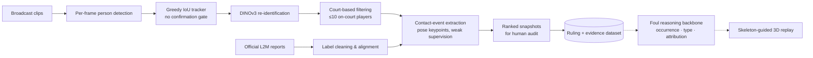

# Evidence-Grounded Foul Explanations for NBA Broadcast Video

> Can a system explain a foul call the way the NBA's Last Two Minute (L2M) Report does — but with the physical evidence attached?


Siyu Wang · Master of Research, University of Technology Sydney

---

## Motivation

Since 2015–16 the NBA has published **Last Two Minute (L2M) Reports**: a ruling for every whistle in the final two minutes of close games, plus a one-line comment such as *"Tate (HOU) makes contact with Smart's (LAL) arm, which affects his jump shot attempt."*

The ruling is public; **the evidence behind it is not** — which players, which body parts, over which frames. And broadcast video is hardest to read exactly where fouls happen: players overlapping under the basket, tight framing, fast motion.

This project builds the pipeline that recovers that evidence, and designs a model that uses it.

---

## Pipeline


<sub>Solid: implemented. Dashed: designed, next steps.</sub>

---

## Highlights

### 1. Diagnosing a tracker failure — and fixing it by design
Running **BoT-SORT** on broadcast basketball, most frames kept only **1–2 tracks** despite many visible players. A frame-level diagnostic separating detector from tracker showed the detector finding **9 people** where the tracker kept **2**: a **78% loss caused by track-confirmation gating**, not detection.

- Tried a scene-aware variant (PySceneDetect, reset at cuts): fixed hard cuts, but most misses were in slow zooms and pans.
- **Final design:** decouple detection from confirmation — every detection gets an identity via a greedy IoU tracker, and a **DINOv3-based ReID** module stitches identities back after occlusion.
- **Result:** **1–2 → 40–55 tracks per frame**, consistent with independent detection counts; also validated on a synthetic 9-person dense-occlusion stress test.

### 2. Court-based, not jersey-based, player filtering
Spectators wear jerseys too — often facing the camera, closer and more legible than players. So instead of reading numbers, the pipeline keeps tracks **inside the calibrated court boundary** and caps the result at **15 people per frame** (10 players plus referees, with margin). Two modes: fixed sideline lines, or a **colour-adaptive** floor model (HSV, Mahalanobis distance) that stays correct when the camera zooms or pans.

### 3. Official rulings as ground truth
`637` cleaned L2M ruling records across `26` games, aligned to `634` processed clips. The league's rulings are used as authoritative labels; the open problem is extracting the *evidence*.

### 4. Weakly supervised contact events
For each pair of on-court players, the minimum wrist-to-arm/torso keypoint distance is compared with a **scale-adaptive threshold**:

```
threshold = CONTACT_RATIO × mean(bbox long side of both players),   CONTACT_RATIO = 0.14
```

Frames are merged into events with a 3-frame gap tolerance. Output is a **candidate pool for human review**, ranked and exported as snapshots — not auto-labels, since legal contact (screens, box-outs) also triggers it.

### 5. Production-minded batch processing
Resumable runs (each step skipped if its output exists), per-clip timeouts that kill stuck jobs and move on, CSV status logs, and atomic writes (temp file → replace) for tracking outputs on the shared HPC filesystem.

---

## Status

| Component | Status |
|---|---|
| Decoupled detection–tracking + DINOv3 ReID | ✅ Implemented & validated |
| Court-based track filtering | ✅ Implemented |
| Batch orchestration (resumable, timeout, CSV log) | ✅ Implemented |
| L2M cleaning and video–label alignment | ✅ Implemented |
| Contact-event extraction (first foul category) | ✅ Implemented, validated on real officiated clips |
| Ranked snapshot export for human audit | ✅ Implemented |
| Task-specific foul reasoning backbone | 📝 Designed |
| Skeleton-guided open-vocabulary 3D replay, evaluated against L2M rulings | 📝 Designed |

---

## Code

```text
nba-foul-evidence/
├── batch_process.py                     # resumable batch runner: tracking → court filter, per-clip timeout, CSV log
├── tracking/
│   ├── run_inference_decoupled.py       # YOLOv8 detection + IoU tracker + DINOv3 ReID + per-crop pose, scene-cut resets
│   └── filter_on_court_players.py       # sideline calibration (fixed or colour-adaptive) + per-frame cap
├── data/
│   ├── clean_l2m_labels.py              # raw L2M JSON → processed/l2m_clean.jsonl
│   └── check_l2m_alignment.py           # match L2M rulings to tracked clips, report match rate
├── evidence/
│   ├── extract_hand_check_labels.py     # scale-adaptive wrist-to-body contact events
│   └── export_event_snapshots.py        # top-k events → annotated closest-contact frame (JPG) for review
└── requirements.txt
```

Videos, L2M downloads and model weights are not included. NBA broadcast footage is copyrighted; obtain clips and L2M reports from official sources.

### Quick start

```bash
pip install -r requirements.txt

# 1. Track and filter every clip (resumable)
python batch_process.py --video-dir videos/ --annotations-dir annotations/ \
    --sideline-points-dir sideline_points/ --log batch_log.csv

# 2. Clean L2M reports and check alignment with the tracked clips
python data/clean_l2m_labels.py --input_dir raw/l2m_json --output_jsonl processed/l2m_clean.jsonl
python data/check_l2m_alignment.py --l2m_jsonl processed/l2m_clean.jsonl --annotations_dir annotations/

# 3. Extract candidate contact events and export snapshots for review
python evidence/extract_hand_check_labels.py --annotations-dir annotations/ \
    --output-dir processed/hand_check_labels/ --summary-csv processed/hand_check_summary.csv
python evidence/export_event_snapshots.py --video-dir videos/ --annotations-dir annotations/ \
    --events-dir processed/hand_check_labels/ --output-dir qa_report/hand_check_snapshots/ --top-k 8
```

**Tech:** Python · YOLOv8 · DINOv3 · pose estimation · PySceneDetect · OpenCV · HPC · JSONL data pipelines
